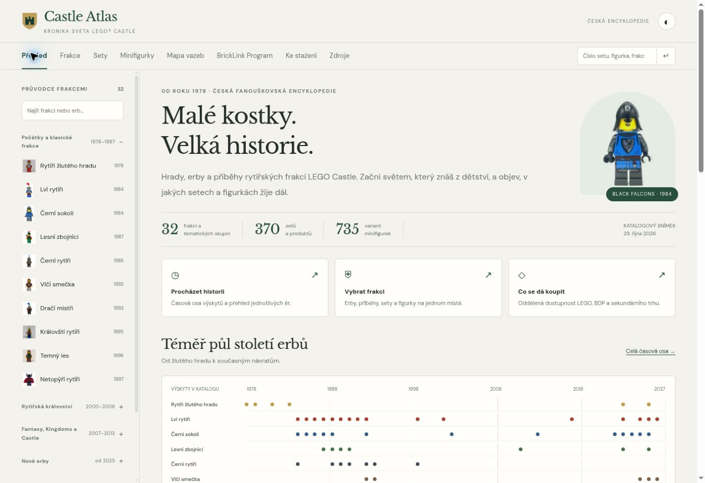

# Porovnání Castle webů a návrh GPT v2

Posouzení nasazených verzí a jejich zdrojů z 30. 10. 2026. Jde o hodnocení použitelnosti a rozsahu implementací, nikoliv o úplný audit historických údajů. Rozdílné počty frakcí nejsou přímo srovnatelné: některé weby spojují celé řady, jiné rozlišují jednotlivé strany a příbuzné tematické skupiny.

| Oblast | Claude — Hradní kronika | GPT v1 — Castle Atlas | Gemini — Castle Codex | Rozhodnutí pro GPT v2 |
| --- | --- | --- | --- | --- |
| Orientace | Stálý boční seznam s figurkami a dělením podle ér. Velmi rychlé přeskakování mezi tématy. | Boční filtr je až pod velkou úvodní plochou; část frakcí je na dalších stránkách karet. | Výrazná horní navigace, na kontrolované šířce ale přetéká do vodorovného posuvu. | Boční index na každé stránce, rozbalovací období, hledání přímo v seznamu; na mobilu sbalitelný. |
| Vizuál a čtení | Nejlepší pro informační web. Přirozený článek, jasné nadpisy, obsah má přednost. | Dobré fotografie a barevnost, působí spíše jako prezentační stránka. Příliš dominantní hero. | Soudržná tmavá fantasy atmosféra; zlato a ozdobná typografie jsou výrazné, na delší čtení ale únavnější. | Světlá kronika s tlumenou zelenou a decentní zlatou, čitelná serifová hierarchie, kompaktní úvod. Volitelný tmavý režim. |
| Historie a souvislosti | Silná stránka: časová osa, původní řady, návraty, příběhy a rozlišení tvrzení. | Krátké texty frakcí, historie se ztrácí vedle katalogu. | Dobře viditelné chronologické milníky a diagram. | Přehled ér, celá časová osa katalogových výskytů; doložené tvrzení a fanouškovská teorie jsou označené. |
| Katalog | Dobře vybrané příklady v kontextu. | 370 setů/produktů, 735 variant figurek; konkrétní inventáře a obousměrné odkazy. | Menší ručně zadaný výběr; počet 13 frakcí a označení „kompletní“ nevystihují rozsah proti databázi GPT. | Zachovat všechna původní data, inventáře i samostatné adresy. Přidat úsporný seznam a volitelné karty. |
| Vztahy | Příběhový diagram je užitečný pro kontext. | Vazby jsou ukryté v setech. | Diagram má vlastní prominentní sekci. | Interaktivní mapa společných setů počítaná z minifigurek. Příběhové aliance a fanouškovské domněnky se do ní nepromítají jako fakt. |
| Vyhledávání | Dobrá navigace bez opakovaného hledání úvodní stránky. | Užitečné filtry, stav se však nesdílí adresou. | Globální hledání, filtry a exporty jsou dobrý nápad. | Jedno hledání přes frakce, sety a figurky; filtry i záložky v URL, zachování po reloadu. |
| Export | Není hlavním účelem stránky. | JSON ve zdrojích. | Samostatný panel s CSV a JSON. | Samostatné exporty a CSV právě filtrovaných výsledků, včetně výsledků na dalších stránkách. |
| Dostupnost a původ tvrzení | Dodaný skript pro opakovanou kontrolu, viditelné informační štítky. | Uvádí konkrétní datum kontroly a omezení; rozlišuje chybějící inventář a erbovní odkaz. | V dodaném katalogu jsou starší sety označené jako prodej na LEGO.cz; nebrat je jako ověřený živý stav. Hlavička říká „oficiální archív“, přestože jde o fanouškovský web. | Zachovat datovanou dostupnost a původ záznamů. Jasně uvádět fanouškovský charakter a neúplnost nových inventářů. |

## Co je ve v2 hotové

- Trvalý a prohledávatelný seznam všech 32 frakcí / skupin s figurkami.
- Menší úvod, srozumitelné kapitoly historie a klikací časová osa výskytů.
- Článkový detail frakce s rozpoznáním erbu, kontextem, označenými teoriemi a katalogem.
- Mapa společných setů s rozbalením konkrétních inventářů.
- Globální hledání, adresy filtrů, seznam / karty, CSV a JSON, světlý / tmavý vzhled.
- Zachované detaily všech 370 setů a 735 figurek a externí zdrojové katalogy.

## Verze a adresy

Samostatné složky jsou pro toto porovnávání praktičtější než větve: obě verze jsou dostupné souběžně a není potřeba přepínat deployment větve.

- `bricks-gpt-v1/` v repozitáři `bricks`: archiv původních zdrojů včetně katalogu a obrazových archivů.
- https://vinmat.eu/bricks-gpt-v1/cs/castle/: veřejná v1.
- `castle-GPT/`: aktuální zdroje v2.
- https://vinmat.eu/bricks-gpt/cs/castle/: veřejná v2.

Claude a Gemini se touto úpravou nemění. Na úrovni historie commitu zůstává navíc možnost dohledat starší zdroje.

## Náhled nové verze

